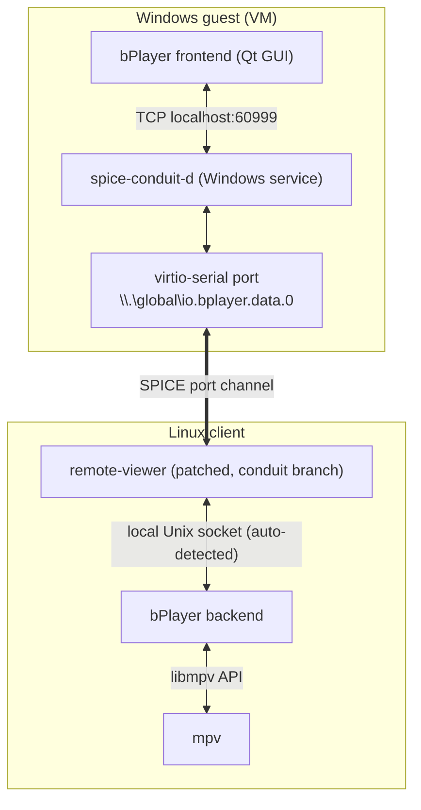

# Charon — Client-Side Multimedia for SPICE virtual desktops

> **Status: archived Proof of Concept (2020–2021) — outcome: positive.**
> The concept was validated end to end. The code is published for reference and is not maintained.

> [!CAUTION]
> **Use entirely at your own risk.** This is experimental proof-of-concept code, provided "AS IS", without warranty of any kind and without support. It has **not** undergone a security review and contains known weaknesses (see [Security & risk assessment](#security--risk-assessment)). Do not use it in production or on systems handling sensitive data. By using, building, or deploying any part of this project you accept full responsibility for the outcome; the author shall not be liable for any claim, damage, data loss, security incident, or other liability arising from it. See [Disclaimer](#disclaimer).

## The problem

In a virtual desktop (Windows guest on KVM/QEMU, accessed through SPICE), multimedia playback is decoded **inside the VM** and the decoded frames are then re-encoded and pushed to the client as a remote display. The result is high CPU load on the host, heavy bandwidth, and choppy audio/video on the client — while the client machine sitting in front of the user has a perfectly capable GPU and decoder doing nothing.

## The idea

Don't send pixels — send the **original compressed stream**.

Charon ferries the media file, still compressed, from the Windows guest across the SPICE connection to the Linux client, where it is decoded and played locally with the client's own capabilities (hardware decoding, local audio). The guest only sends playback commands and the raw byte stream; the client does the heavy lifting.

## Architecture

1. **bPlayer frontend** (guest) — the user drops a media file; the frontend serves its bytes and sends control commands (play, pause, seek, volume) through a custom stream/control protocol.
2. **spice-conduit-d** (guest) — a Windows service that bridges the local TCP endpoint to the virtio-serial port `io.bplayer.data.0`, declared in the VM's libvirt XML as a SPICE port channel.
3. **remote-viewer, patched** (client) — the SPICE client exposes the port channel as a local socket (`NetworkLocalServer`) in a temporary folder.
4. **bPlayer backend** (client) — finds the socket, feeds the stream to **mpv** through its IPC interface, and forwards playback state (position, state, volume) back to the frontend.

## Repositories

| Repository | Side | Role | License |
|---|---|---|---|
| [bPlayer](https://github.com/unau-thorized/bPlayer) | guest + client | Frontend (Qt GUI), backend (mpv controller), shared protocol library, socket-bridge tool | GPL-2.0 |
| [spice-conduit-d](https://github.com/unau-thorized/spice-conduit-d) | guest | Windows service bridging local endpoint ↔ virtio-serial port | MIT |
| [virt-viewer](https://github.com/unau-thorized/virt-viewer/tree/conduit) (`conduit` branch) | client | Fork of upstream virt-viewer 9.0 adding the conduit local socket | GPL-2.0 (upstream) |

## Outcome

The PoC was tested and worked: audio and video files selected inside the Windows guest were streamed compressed over SPICE and played back natively on the Linux client, with remote control of playback from the guest.

**Scope.** The PoC covers media files stored locally in the VM. Since decoding is delegated to mpv, the whole range of audio and video formats supported by mpv/FFmpeg is available without extra work.

**Test results.** The client side was tested on low-end hardware — a plain Pentium dual-core thin client with 4 GB of RAM — playing **1080p H.264 and H.265** video **without dropped frames**. CPU/iGPU load on the client naturally differed between the two codecs, but playback stayed smooth in both cases. On even weaker hardware, mpv's frame-dropping offers a graceful fallback instead of stuttering.

This is the point of the concept: a modest client can play media that would be unwatchable if decoded inside the VM and pushed as remote display frames.

Known functional limitations at the time of archiving:

- the backend could crash after the first playback when mpv was quit from its OSD;
- the frontend talks to spice-conduit-d over TCP instead of a named pipe;
- seeking had no visual feedback and could be slow;
- build systems are qmake/autotools; the guest service requires MSVC (MinGW lacks `CancelIoEx`).

## Security & risk assessment

The PoC was built to prove feasibility, not to be safe. The design and the code have the issues below. Anyone reusing the idea should treat this section as a starting point, not an exhaustive audit.

### Design-level risks

| # | Risk | Severity | Notes |
|---|---|---|---|
| D1 | **VM isolation boundary crossed by untrusted data.** Bytes chosen by the guest are demuxed and decoded by libmpv/FFmpeg on the client. A compromised guest (or a malicious media file opened in it) can target parser vulnerabilities on the client machine. | High | Inherent to the concept. This is the price of client-side decoding. |
| D2 | **No authentication or integrity on the channel.** Any process able to reach the guest endpoint can inject stream data and playback commands. | Medium | No handshake, no session token, no message authentication. |
| D3 | **No input validation / resource limits on protocol messages.** Message sizes, seek offsets and command arguments coming from the guest are trusted. | Medium | Potential crashes or DoS of the client-side backend. |
| D4 | **Unmaintained dependencies.** Qt 5, virt-viewer 9.0 (2020), libmpv/FFmpeg of that period. | Medium | Known CVEs in those versions are not patched here. |

### Implementation-level findings

| # | Component | Finding | Severity |
|---|---|---|---|
| I1 | bPlayer backend | mpv is started with `input-ipc-server=/tmp/mpvsocket`: a **fixed, predictable path in a world-writable directory**. Another local user can pre-create/squat the path, and anyone who can connect to the mpv IPC socket can issue arbitrary mpv commands, including `run` (command execution as the user running the backend). The IPC server is not needed by the PoC and should be removed. | High |
| I2 | virt-viewer `conduit` | The temporary folder `/tmp/remote-viewer-<pid>` is created with mode `0777` and a predictable name, then hosts the conduit Unix socket. Other local users can access the socket or race the folder creation. | High |
| I3 | spice-conduit-d | The local server is created with `QLocalServer::WorldAccessOption`: every user in the guest, including unprivileged ones, can connect to the conduit. | Medium |
| I4 | spice-conduit-d | `Service-Install.ps1` registers the service with the default account (**LocalSystem**). A bug in the service runs with the highest privileges in the guest. | Medium |
| I5 | bPlayer frontend ↔ conduit | Localhost TCP (`60999`) instead of a named pipe with an ACL: any local process can connect. | Medium |
| I6 | All | Debug logging to stdout/console, no hardening flags, no fuzzing, no tests. | Low |

## Envisioned evolution: browser redirection

The natural next step, never implemented, was a **browser extension** (e.g. for Chrome) that intercepts web media playback inside the VM and redirects the stream into the Charon channel, so that web video would also be decoded and played on the client instead of inside the VM.

Points anyone exploring this should consider:

- a browser extension cannot open the conduit by itself: it needs a companion **native messaging host** in the guest, which becomes a new privileged bridge between web content and the client;
- the stream source becomes **remote, untrusted web content**, which widens risk D1 considerably: client-side sandboxing of the decoder (improvement 7) becomes mandatory, not optional;
- adaptive streaming (HLS/DASH) and **DRM-protected** content (EME/Widevine) cannot simply be redirected; the realistic target is unencrypted media, or passing the URL rather than the bytes when the client is allowed to reach it directly — which in turn raises network-policy and data-leak questions in managed environments.

## Possible improvements and fixes

If someone wants to take the concept further, in rough order of priority:

1. **Remove the mpv IPC server** (I1); control mpv only through the libmpv API that is already in use.
2. **Private runtime directory on the client** (I2): use `$XDG_RUNTIME_DIR` (or `g_get_user_runtime_dir()`), create it with `0700`, and verify ownership; never use a predictable path in `/tmp`.
3. **Restrict the guest endpoint** (I3, I5): a named pipe with an ACL limited to the interactive user, instead of world access or a TCP port.
4. **Least privilege for the guest service** (I4): run as `LocalService` or a virtual service account, or drop the service entirely by fixing the virtio-serial port ACL via the driver `.inf`/registry, as already sketched in the bPlayer notes.
5. **Authenticated sessions** (D2): a per-session token exchanged at startup, plus message authentication.
6. **Strict protocol parsing** (D3): bounds on message size, offsets and rates; reject unknown message types.
7. **Contain the decoder** (D1): run the backend/mpv in a sandbox (bubblewrap, Flatpak portal, seccomp, separate user) and allow-list the demuxers/codecs that are actually needed.
8. **Modernise the stack** (D4): Qt 6, CMake, a current virt-viewer or a standalone SPICE port client via spice-gtk, current libmpv.
9. **Functional fixes:** the mpv controller lifecycle crash, seek feedback, moving `common/` into a library, a single-threaded stream handler.
10. **Tests and fuzzing** of the protocol parser and the stream path.

## Building

Each repository has its own build notes. In short: Qt 5 + QtCreator for bPlayer and spice-conduit-d (the latter also needs [QtService](https://github.com/Skycoder42/QtService)); autotools for the virt-viewer fork.

## Author

*Unau Thorized* · [spaziocurvo.com](https://www.spaziocurvo.com)

## License

This repository (documentation) is released under the [MIT License](LICENSE). Each component repository keeps its own license, as listed above.

## Disclaimer

This project is a historical proof of concept published for educational and reference purposes only. It is provided "AS IS", without warranty of any kind, express or implied, including but not limited to the warranties of merchantability, fitness for a particular purpose, security, and non-infringement. It is not maintained, not supported, and not intended for production use.

You use, build, modify, or deploy any part of this project **solely at your own risk**. You are responsible for assessing its suitability and security for your environment. In no event shall the author or contributors be liable for any claim, damages (direct, indirect, incidental, special, or consequential), data loss, security breach, downtime, or other liability, whether in contract, tort, or otherwise, arising from or in connection with this project or its use.

The security findings listed above are provided for transparency; their absence from the list does not imply that any other part of the code is safe.
